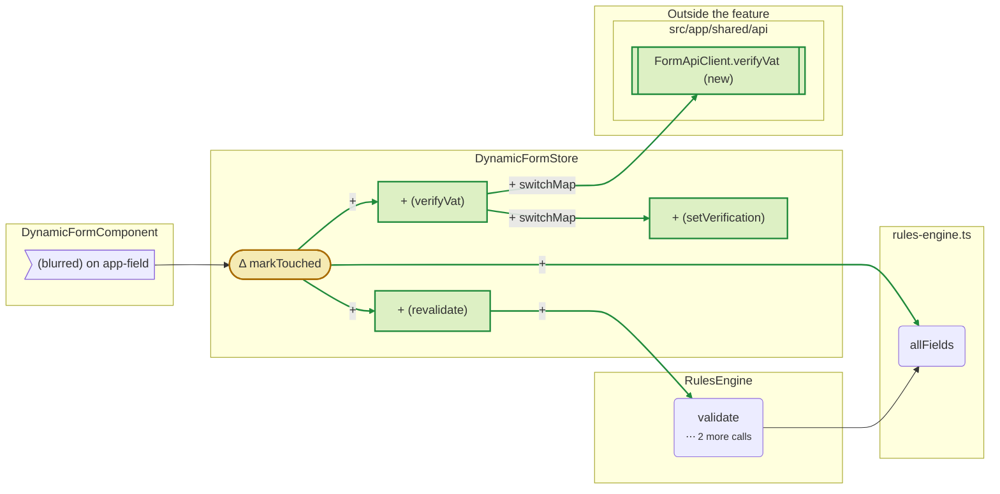
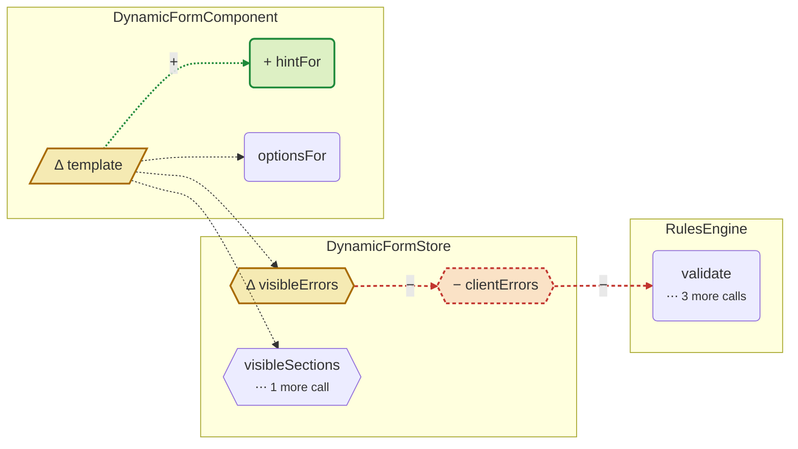
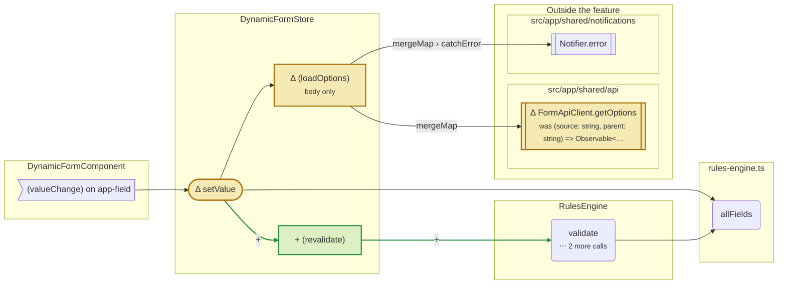
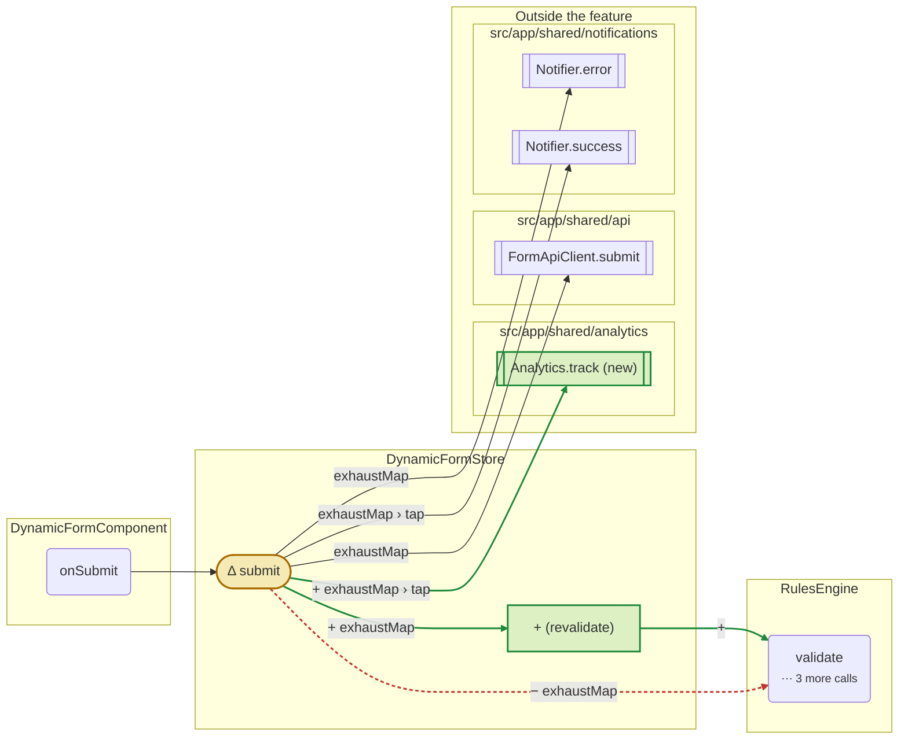
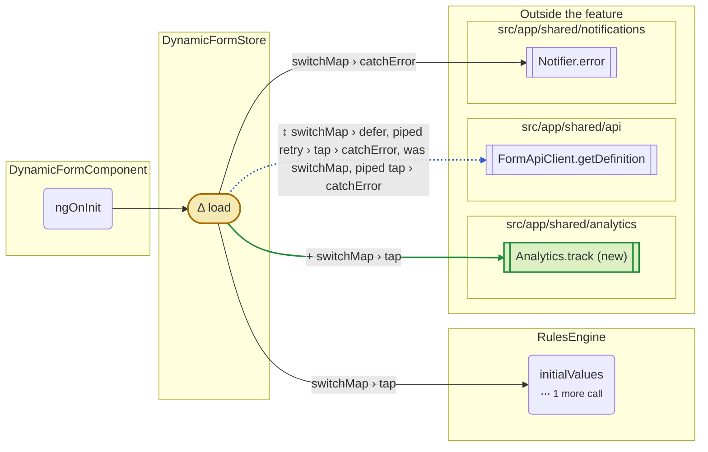
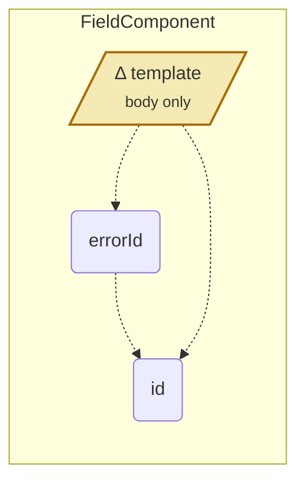

## Call graph diff

`main (fixtures/base)` → `feature/vat-check (fixtures/pr)` · `src/app/features/dynamic-form` · **4 store methods**: 4 changed, 0 added, 0 removed, 0 unchanged · 2 changes outside them

Each diagram is a store method and the code it can reach, read from the source on both sides. + added · − removed · Δ changed · ↕ moved to a different point. Code outside the feature is shown but not followed.

#### What changed

- + **DynamicFormStore** `(revalidate)` now calls **RulesEngine** `validate()` · in 3 diagrams
- + **DynamicFormStore** `markTouched()` now calls **DynamicFormStore** `(revalidate)` · in DynamicFormStore.markTouched
- + **DynamicFormStore** `markTouched()` now calls **DynamicFormStore** `(verifyVat)` · in DynamicFormStore.markTouched
- + **DynamicFormStore** `markTouched()` now calls **rules-engine.ts** `allFields()` · in DynamicFormStore.markTouched
- + **DynamicFormStore** `(verifyVat)` now calls **DynamicFormStore** `(setVerification)` · in DynamicFormStore.markTouched
- + **DynamicFormStore** `(verifyVat)` now calls **FormApiClient** `verifyVat()` · in DynamicFormStore.markTouched
- − **DynamicFormStore** `clientErrors()` no longer calls **RulesEngine** `validate()` · in DynamicFormStore.clientErrors and 3 more
- + **DynamicFormStore** `setValue()` now calls **DynamicFormStore** `(revalidate)` · in DynamicFormStore.setValue
- Δ **FormApiClient** `getOptions()` takes or returns something else: `(source: string, query: { parent: string; locale: string; }) => Observable<Opti…` instead of `(source: string, parent: string) => Observable<OptionDto[]>` · in DynamicFormStore.setValue
- + **DynamicFormStore** `submit()` now calls **DynamicFormStore** `(revalidate)` · in DynamicFormStore.submit
- + **DynamicFormStore** `submit()` now calls **Analytics** `track()` · in DynamicFormStore.submit
- − **DynamicFormStore** `submit()` no longer calls **RulesEngine** `validate()` · in DynamicFormStore.submit
- … and 11 more

| Diagram | | Changes | Dependencies outside the feature |
|---|---|---|---|
| DynamicFormStore.markTouched | changed | +6 Δ1 | + FormApiClient.verifyVat |
| DynamicFormStore.clientErrors and 3 more | changed | +1 −2 Δ2 |  |
| DynamicFormStore.setValue | changed | +2 Δ3 |  |
| DynamicFormStore.submit | changed | +3 −1 Δ1 | + Analytics.track |
| DynamicFormStore.load | changed | +1 Δ1 ↕1 | + Analytics.track |
| FieldComponent template | changed | Δ1 |  |

### Changed: DynamicFormStore.markTouched

`src/app/features/dynamic-form/dynamic-form.store.ts` · +6 Δ1 · new dependency: **FormApiClient.verifyVat**

- + **DynamicFormStore** `(revalidate)` now calls **RulesEngine** `validate()`
- + **DynamicFormStore** `markTouched()` now calls **DynamicFormStore** `(revalidate)`
- + **DynamicFormStore** `markTouched()` now calls **DynamicFormStore** `(verifyVat)`
- + **DynamicFormStore** `markTouched()` now calls **rules-engine.ts** `allFields()`
- + **DynamicFormStore** `(verifyVat)` now calls **DynamicFormStore** `(setVerification)`
- + **DynamicFormStore** `(verifyVat)` now calls **FormApiClient** `verifyVat()`
- Δ **DynamicFormStore** `markTouched()` now also reads `definition`, `values`, `verifications`

Call graph diff

### Changed: DynamicFormStore.clientErrors and 3 more

`src/app/features/dynamic-form/dynamic-form.store.ts` · +1 −2 Δ2

- − **DynamicFormStore** `clientErrors()` no longer calls **RulesEngine** `validate()`
- Δ **DynamicFormStore** `visibleErrors()` now also reads `clientErrors`, `verifications`
- − **DynamicFormStore** `visibleErrors()` no longer reads **DynamicFormStore** `clientErrors()`
- + **DynamicFormComponent** template now reads **DynamicFormComponent** `hintFor()`

Call graph diff

### Changed: DynamicFormStore.setValue

`src/app/features/dynamic-form/dynamic-form.store.ts` · +2 Δ3

- + **DynamicFormStore** `(revalidate)` now calls **RulesEngine** `validate()`
- + **DynamicFormStore** `setValue()` now calls **DynamicFormStore** `(revalidate)`
- Δ **FormApiClient** `getOptions()` takes or returns something else: `(source: string, query: { parent: string; locale: string; }) => Observable<Opti…` instead of `(source: string, parent: string) => Observable<OptionDto[]>`
- Δ **DynamicFormStore** `setValue()` now also reads `submitAttempted`, `touched`
- Δ **DynamicFormStore** `(loadOptions)` changed, but not what it calls or the state it uses

Call graph diff

### Changed: DynamicFormStore.submit

`src/app/features/dynamic-form/dynamic-form.store.ts` · +3 −1 Δ1 · new dependency: **Analytics.track**

- + **DynamicFormStore** `(revalidate)` now calls **RulesEngine** `validate()`
- + **DynamicFormStore** `submit()` now calls **DynamicFormStore** `(revalidate)`
- + **DynamicFormStore** `submit()` now calls **Analytics** `track()`
- − **DynamicFormStore** `submit()` no longer calls **RulesEngine** `validate()`
- Δ **DynamicFormStore** `submit()` now also reads `clientErrors`
- Δ **DynamicFormStore** `submit()` no longer reads `definition`

Call graph diff

### Changed: DynamicFormStore.load

`src/app/features/dynamic-form/dynamic-form.store.ts` · +1 Δ1 ↕1 · new dependency: **Analytics.track**

- + **DynamicFormStore** `load()` now calls **Analytics** `track()`
- ↕ **DynamicFormStore** `load()` calls **FormApiClient** `getDefinition()` at a different point: `switchMap › defer, piped retry › tap › catchError` (was `switchMap, piped tap › catchError`)

Call graph diff

### Changed: FieldComponent template

`src/app/features/dynamic-form/field.component.ts` · Δ1

- Δ **FieldComponent** template changed, but not what it calls or the state it uses

Call graph diff

