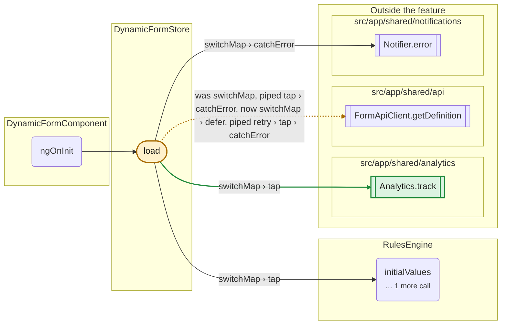
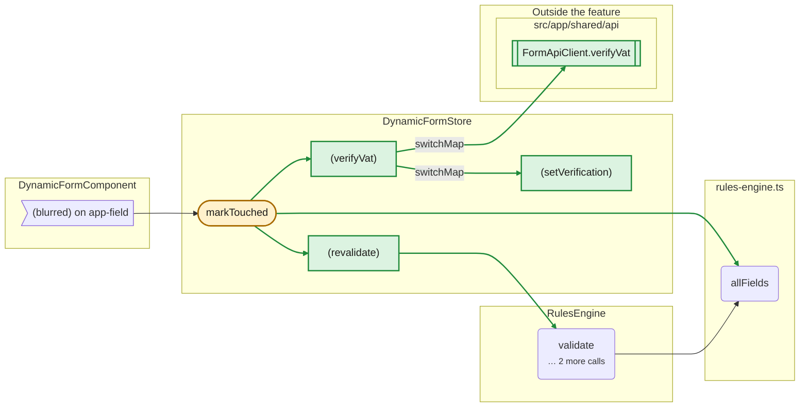
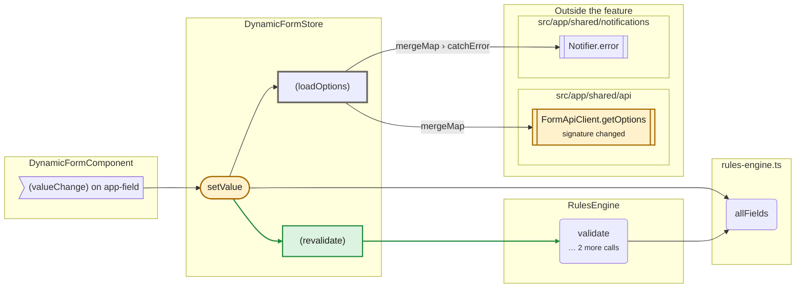
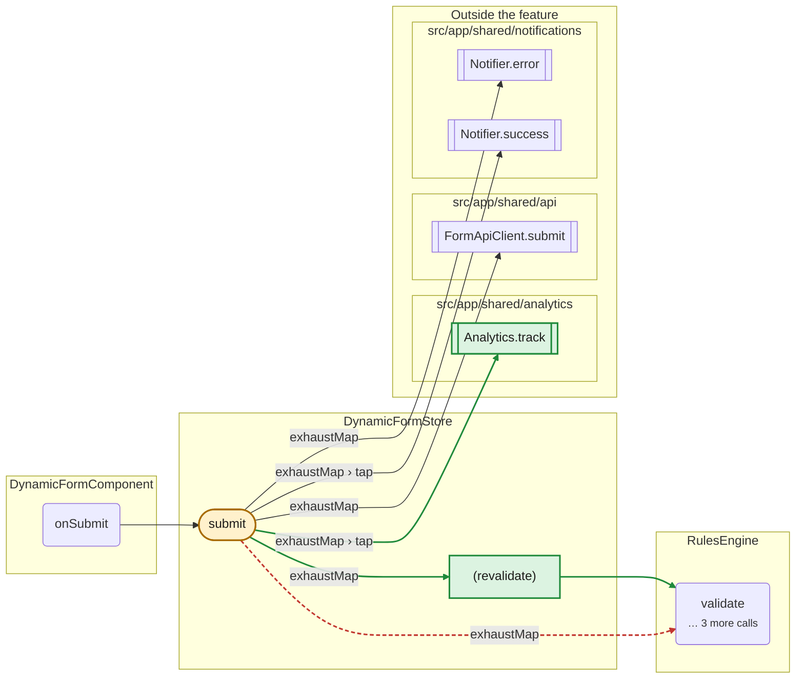
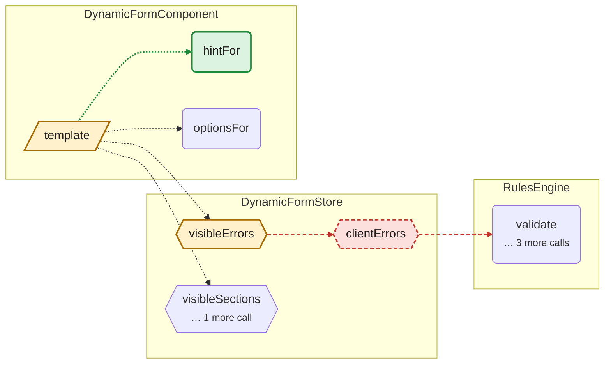
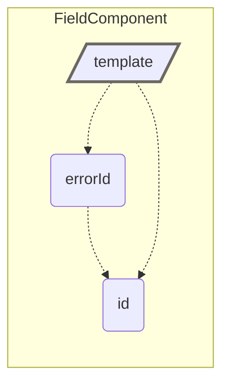

## Call graph changes in `src/app/features/dynamic-form`

`main (fixtures/base)` → `feature/vat-check (fixtures/pr)` · **8** changed, **4** added, **1** removed in the feature · dependencies outside it: **+2 −0**, **1** with a changed signature

Green: added · red, dashed: removed · amber: calls changed (dashed: same calls, different place) · blue: state access changed · thick outline: body changed only. Solid arrows are calls, dotted arrows are reads, thick arrows are outputs reaching a parent template.

| Change | Where | What |
|---|---|---|
| calls changed | `DynamicFormComponent template` | now calls DynamicFormComponent.hintFor |
| calls changed | `DynamicFormStore.load` | now calls Analytics.track; calls FormApiClient.getDefinition from a different place: was switchMap, piped tap › catchError, now switchMap › defer, piped retry › tap › catchError |
| calls changed | `DynamicFormStore.markTouched` | now calls DynamicFormStore.(revalidate), DynamicFormStore.(verifyVat), allFields; now reads definition, values, verifications |
| calls changed | `DynamicFormStore.setValue` | now calls DynamicFormStore.(revalidate); now reads submitAttempted, touched |
| calls changed | `DynamicFormStore.submit` | now calls DynamicFormStore.(revalidate), Analytics.track; no longer calls RulesEngine.validate; now reads clientErrors; no longer reads definition |
| calls changed | `DynamicFormStore.visibleErrors` | no longer calls DynamicFormStore.clientErrors; now reads clientErrors, verifications |
| signature changed | `FormApiClient.getOptions` (outside) | signature: (source: string, parent: string) => Observable<OptionDto[]> → (source: string, query: { parent: string; locale: string; }) => Observable<OptionDto[]>; called by DynamicFormStore.(loadOptions) |
| added | `Analytics.track` (outside) | called by DynamicFormStore.load, DynamicFormStore.submit |
| added | `DynamicFormComponent.hintFor` | called by DynamicFormComponent template |
| added | `DynamicFormStore.(revalidate)` | called by DynamicFormStore.markTouched, DynamicFormStore.setValue, DynamicFormStore.submit; calls RulesEngine.validate; writes clientErrors |
| added | `DynamicFormStore.(setVerification)` | called by DynamicFormStore.(verifyVat); writes verifications |
| added | `DynamicFormStore.(verifyVat)` | called by DynamicFormStore.markTouched; calls DynamicFormStore.(setVerification), FormApiClient.verifyVat |
| added | `FormApiClient.verifyVat` (outside) | called by DynamicFormStore.(verifyVat) |
| removed | `DynamicFormStore.clientErrors` | was called by DynamicFormStore.visibleErrors; called RulesEngine.validate |
| body changed | `DynamicFormStore.(loadOptions)` | body changed; calls and state access did not |
| body changed | `FieldComponent template` | body changed; calls and state access did not |

### DynamicFormStore.load

### DynamicFormStore.markTouched

### DynamicFormStore.setValue

### DynamicFormStore.submit

### DynamicFormComponent.hintFor, DynamicFormComponent template, DynamicFormStore.clientErrors and 1 more

### FieldComponent template

