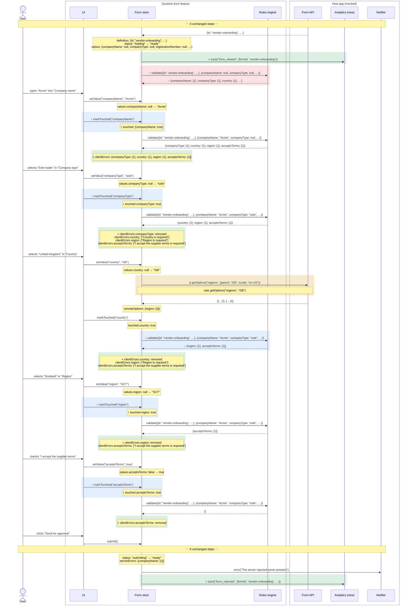
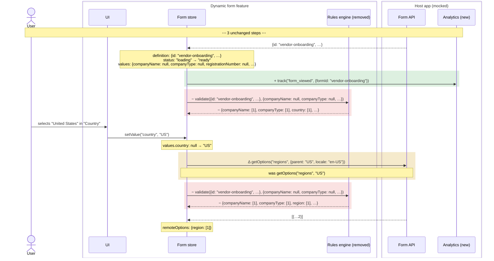
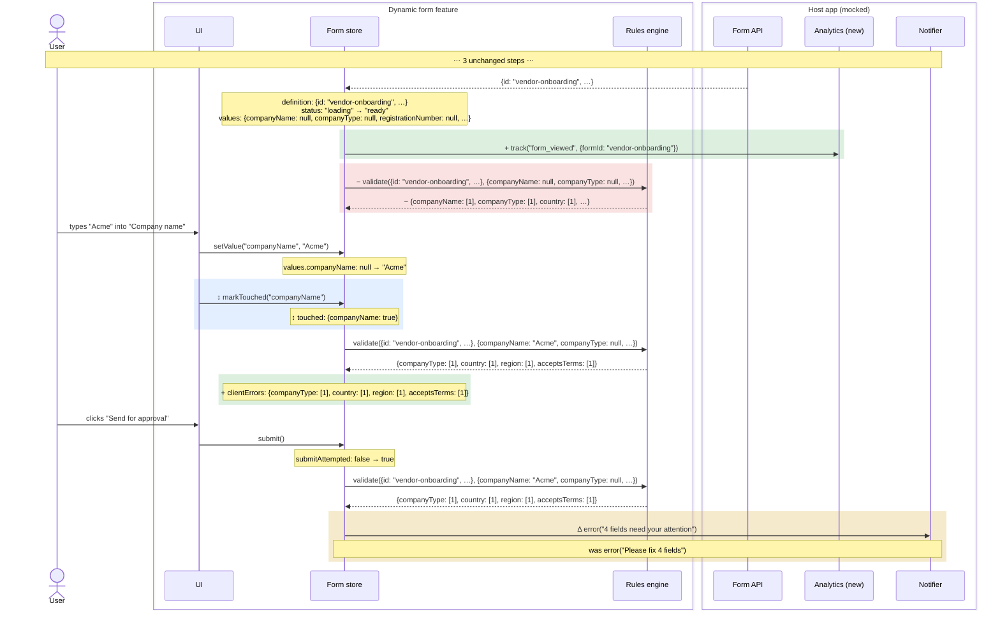
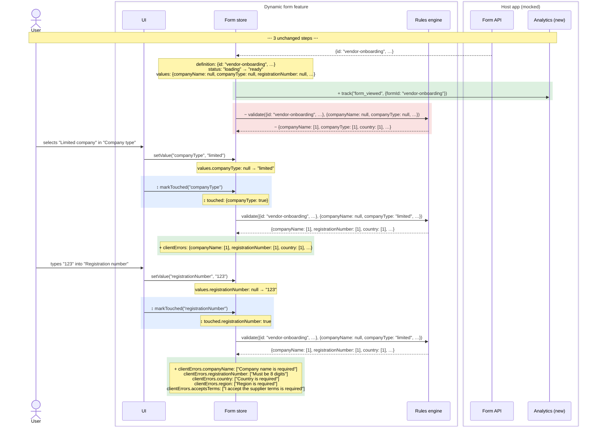
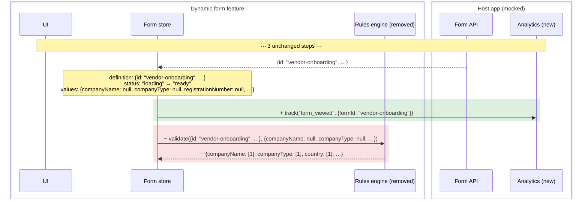
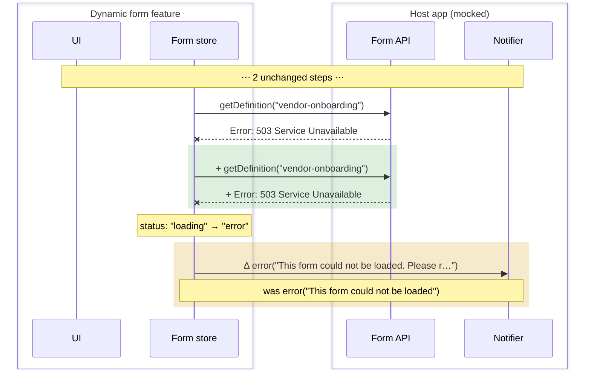
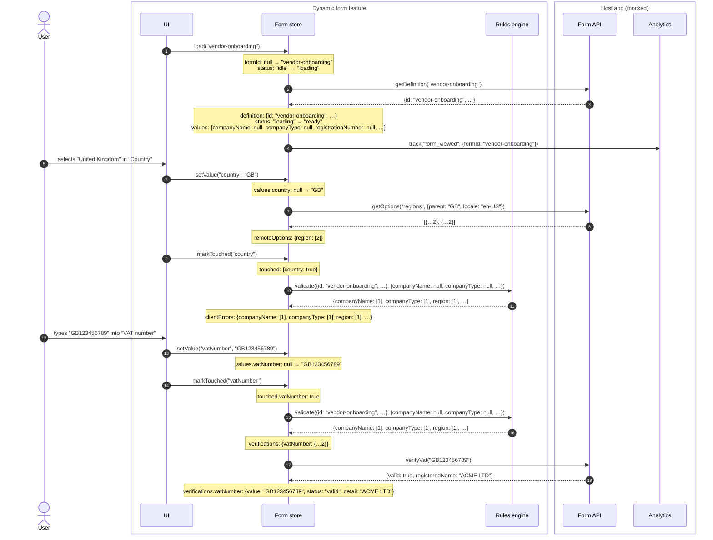

## Behaviour diff

`main (fixtures/base)` → `feature/vat-check (fixtures/pr)` · **8 tests**: 7 changed, 1 added, 0 removed, 0 unchanged (1 renamed)

Each diagram is one integration test, recorded on both sides. + added · − removed · Δ changed · ↕ moved. Unchanged stretches are collapsed.

| Test | | Steps | Participants |
|---|---|---|---|
| Dynamic form shows field errors returned by the server | changed | +7 −2 Δ1 ↕10 | + Analytics |
| Dynamic form submits a valid form and shows the reference | changed | +7 −2 Δ1 ↕10 | + Analytics |
| Dynamic form loads regions for the selected country | changed | +1 −4 Δ1 | + Analytics, − Rules engine |
| Dynamic form lists what is missing when submitted too early was: Dynamic form blocks submission while required fields are missing | renamed | +2 −2 Δ1 ↕2 | + Analytics |
| Dynamic form shows and validates the registration number only for limited companies | changed | +3 −2 ↕4 | + Analytics |
| Dynamic form loads the form definition from the backend and renders its sections | changed | +1 −2 | + Analytics, − Rules engine |
| Dynamic form tells the user when the form cannot be loaded | changed | +2 Δ1 |  |
| Dynamic form checks a UK VAT number against the registry when the field is left | added | 28 steps |  |

### Changed: Dynamic form shows field errors returned by the server

`src/app/features/dynamic-form/dynamic-form.integration.spec.ts` · +7 −2 Δ1 ↕10 · new participant: **Analytics**

Sequence diff

Changes as text

- + Form store → Analytics: `track("form_viewed", {formId: "vendor-onboarding"})`
- − Form store → Rules engine: `validate({id: "vendor-onboarding", …}, {companyName: null, companyType: null, …})`
- − Rules engine ⇠ Form store: `{companyName: [1], companyType: [1], country: [1], …}`
- ↕ UI → Form store: `markTouched("companyName")`
- ↕ Form store state: `touched: {companyName: true}`
- + Form store state: `clientErrors: {companyType: [1], country: [1], region: [1], acceptsTerms: [1]}`
- ↕ UI → Form store: `markTouched("companyType")`
- ↕ Form store state: `touched.companyType: true`
- + Form store state: `clientErrors.companyType: removed, clientErrors.country: ["Country is required"], clientErrors.region: ["Region is required"], clientErrors.acceptsTerms: ["I accept the supplier terms is required"]`
- Δ Form store → Form API: `getOptions("regions", {parent: "GB", locale: "en-US"})` (was `getOptions("regions", "GB")`)
- ↕ Form store → Rules engine: `validate({id: "vendor-onboarding", …}, {companyName: "Acme", companyType: "sole", …})`
- ↕ Rules engine ⇠ Form store: `{region: [1], acceptsTerms: [1]}`
- + Form store state: `clientErrors.country: removed, clientErrors.region: ["Region is required"], clientErrors.acceptsTerms: ["I accept the supplier terms is required"]`
- ↕ UI → Form store: `markTouched("region")`
- ↕ Form store state: `touched.region: true`
- + Form store state: `clientErrors.region: removed, clientErrors.acceptsTerms: ["I accept the supplier terms is required"]`
- ↕ UI → Form store: `markTouched("acceptsTerms")`
- ↕ Form store state: `touched.acceptsTerms: true`
- + Form store state: `clientErrors.acceptsTerms: removed`
- + Form store → Analytics: `track("form_rejected", {formId: "vendor-onboarding", …})`

### Changed: Dynamic form submits a valid form and shows the reference

`src/app/features/dynamic-form/dynamic-form.integration.spec.ts` · +7 −2 Δ1 ↕10 · new participant: **Analytics**

Sequence diff

Changes as text

- + Form store → Analytics: `track("form_viewed", {formId: "vendor-onboarding"})`
- − Form store → Rules engine: `validate({id: "vendor-onboarding", …}, {companyName: null, companyType: null, …})`
- − Rules engine ⇠ Form store: `{companyName: [1], companyType: [1], country: [1], …}`
- ↕ UI → Form store: `markTouched("companyName")`
- ↕ Form store state: `touched: {companyName: true}`
- + Form store state: `clientErrors: {companyType: [1], country: [1], region: [1], acceptsTerms: [1]}`
- ↕ UI → Form store: `markTouched("companyType")`
- ↕ Form store state: `touched.companyType: true`
- + Form store state: `clientErrors.companyType: removed, clientErrors.country: ["Country is required"], clientErrors.region: ["Region is required"], clientErrors.acceptsTerms: ["I accept the supplier terms is required"]`
- Δ Form store → Form API: `getOptions("regions", {parent: "GB", locale: "en-US"})` (was `getOptions("regions", "GB")`)
- ↕ Form store → Rules engine: `validate({id: "vendor-onboarding", …}, {companyName: "Acme", companyType: "sole", …})`
- ↕ Rules engine ⇠ Form store: `{region: [1], acceptsTerms: [1]}`
- + Form store state: `clientErrors.country: removed, clientErrors.region: ["Region is required"], clientErrors.acceptsTerms: ["I accept the supplier terms is required"]`
- ↕ UI → Form store: `markTouched("region")`
- ↕ Form store state: `touched.region: true`
- + Form store state: `clientErrors.region: removed, clientErrors.acceptsTerms: ["I accept the supplier terms is required"]`
- ↕ UI → Form store: `markTouched("acceptsTerms")`
- ↕ Form store state: `touched.acceptsTerms: true`
- + Form store state: `clientErrors.acceptsTerms: removed`
- + Form store → Analytics: `track("form_submitted", {formId: "vendor-onboarding", …})`

### Changed: Dynamic form loads regions for the selected country

`src/app/features/dynamic-form/dynamic-form.integration.spec.ts` · +1 −4 Δ1 · new participant: **Analytics** · no longer calls: **Rules engine**

Sequence diff

Changes as text

- + Form store → Analytics: `track("form_viewed", {formId: "vendor-onboarding"})`
- − Form store → Rules engine: `validate({id: "vendor-onboarding", …}, {companyName: null, companyType: null, …})`
- − Rules engine ⇠ Form store: `{companyName: [1], companyType: [1], country: [1], …}`
- Δ Form store → Form API: `getOptions("regions", {parent: "US", locale: "en-US"})` (was `getOptions("regions", "US")`)
- − Form store → Rules engine: `validate({id: "vendor-onboarding", …}, {companyName: null, companyType: null, …})`
- − Rules engine ⇠ Form store: `{companyName: [1], companyType: [1], region: [1], …}`

### Renamed and changed: Dynamic form lists what is missing when submitted too early

`src/app/features/dynamic-form/dynamic-form.integration.spec.ts` · +2 −2 Δ1 ↕2 · was “Dynamic form blocks submission while required fields are missing” · new participant: **Analytics**

Sequence diff

Changes as text

- + Form store → Analytics: `track("form_viewed", {formId: "vendor-onboarding"})`
- − Form store → Rules engine: `validate({id: "vendor-onboarding", …}, {companyName: null, companyType: null, …})`
- − Rules engine ⇠ Form store: `{companyName: [1], companyType: [1], country: [1], …}`
- ↕ UI → Form store: `markTouched("companyName")`
- ↕ Form store state: `touched: {companyName: true}`
- + Form store state: `clientErrors: {companyType: [1], country: [1], region: [1], acceptsTerms: [1]}`
- Δ Form store → Notifier: `error("4 fields need your attention")` (was `error("Please fix 4 fields")`)

### Changed: Dynamic form shows and validates the registration number only for limited companies

`src/app/features/dynamic-form/dynamic-form.integration.spec.ts` · +3 −2 ↕4 · new participant: **Analytics**

Sequence diff

Changes as text

- + Form store → Analytics: `track("form_viewed", {formId: "vendor-onboarding"})`
- − Form store → Rules engine: `validate({id: "vendor-onboarding", …}, {companyName: null, companyType: null, …})`
- − Rules engine ⇠ Form store: `{companyName: [1], companyType: [1], country: [1], …}`
- ↕ UI → Form store: `markTouched("companyType")`
- ↕ Form store state: `touched: {companyType: true}`
- + Form store state: `clientErrors: {companyName: [1], registrationNumber: [1], country: [1], …}`
- ↕ UI → Form store: `markTouched("registrationNumber")`
- ↕ Form store state: `touched.registrationNumber: true`
- + Form store state: `clientErrors.companyName: ["Company name is required"], clientErrors.registrationNumber: ["Must be 8 digits"], clientErrors.country: ["Country is required"], clientErrors.region: ["Region is required"], clientErrors.acceptsTerms: ["I accept the supplier terms is required"]`

### Changed: Dynamic form loads the form definition from the backend and renders its sections

`src/app/features/dynamic-form/dynamic-form.integration.spec.ts` · +1 −2 · new participant: **Analytics** · no longer calls: **Rules engine**

Sequence diff

Changes as text

- + Form store → Analytics: `track("form_viewed", {formId: "vendor-onboarding"})`
- − Form store → Rules engine: `validate({id: "vendor-onboarding", …}, {companyName: null, companyType: null, …})`
- − Rules engine ⇠ Form store: `{companyName: [1], companyType: [1], country: [1], …}`

### Changed: Dynamic form tells the user when the form cannot be loaded

`src/app/features/dynamic-form/dynamic-form.integration.spec.ts` · +2 Δ1

Sequence diff

Changes as text

- + Form store → Form API: `getDefinition("vendor-onboarding")`
- + Form API ✕ Form store: `Error: 503 Service Unavailable`
- Δ Form store → Notifier: `error("This form could not be loaded. Please r…")` (was `error("This form could not be loaded")`)

### New test: Dynamic form checks a UK VAT number against the registry when the field is left

`src/app/features/dynamic-form/dynamic-form.integration.spec.ts` · 28 steps

Sequence diagram

